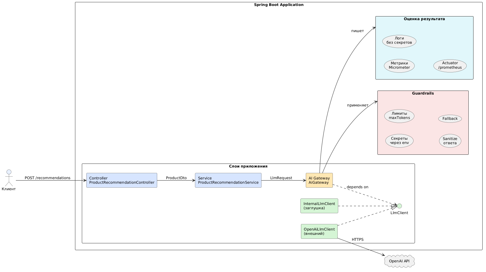

# Лабораторная работа № 1

## Проектирование AI-ready архитектуры Spring Boot-сервиса: AI Gateway, абстракция над LLM-провайдерами и подготовка контекста для AI-ассистента

**Вариант 10. Электронная коммерция. Сервис генерации рекомендаций сопутствующих товаров на основе описания.**

---

## Цели и задачи

**Цель работы:** получить практические навыки проектирования backend-сервисов на Java/Spring Boot, готовых к безопасной интеграции LLM и AI-ассистентов: освоить паттерн AI Gateway, абстракцию над провайдерами моделей, правила AI-ready архитектуры, context engineering и оценку AI-сгенерированного результата с инженерной точки зрения.

**Задачи:**

1. Изучить ключевые идеи архитектуры в эпоху ИИ.
2. Спроектировать слой абстракции `LlmClient` и `AiGateway` для изоляции бизнес-логики от конкретного LLM-провайдера.
3. Реализовать Spring Boot-сервис со слоями Controller → Service → Client → LlmClient.
4. Подготовить AI-ready структуру проекта: правила для пакетов, README для AI-ассистента, архитектурные ограничения.
5. Выполнить сравнение качества ответов LLM при разном контексте.
6. Проанализировать AI-сгенерированный прототип, выявить архитектурные проблемы и предложить инженерную доработку.
7. Оформить результаты с обоснованием принятых решений и отклонённых предложений AI.

---

## Описание варианта

### Предметная область

Электронная коммерция. Интернет-магазин.

### Задача

Сервис принимает данные о товаре (название, категория, описание, цена) и возвращает список рекомендованных сопутствующих товаров (cross-sell), сгенерированный LLM.

### Входные данные - `ProductDto`

- `name` - название товара (обязательное, до 200 символов);
- `category` - категория товара (обязательное, до 200 символов);
- `description` - описание (опционально, до 2000 символов);
- `price` - цена (опционально, положительное число).

### Выходные данные - `RecommendationResponse`

- `recommendations` - список строк с рекомендованными товарами (не более 5);
- `source` - имя провайдера (`openai` / `internal` / `fallback`);
- `fallback` - флаг, был ли применён fallback.

### REST API

```text
POST /api/v1/products/recommendations
Content-Type: application/json
```

**Пример запроса:**

```json
{
  "name": "Кофемашина DeLonghi Magnifica S",
  "category": "Бытовая техника / Кофемашины",
  "description": "Автоматическая кофемашина с капучинатором, 15 бар",
  "price": 45990
}
```

**Пример ответа:**

```json
{
  "recommendations": [
    "Кофейные зерна Arabica 1 кг",
    "Средство для удаления накипи",
    "Набор керамических чашек 6 шт."
  ],
  "source": "internal",
  "fallback": false
}
```

---

## Диаграмма AI Gateway



### Описание слоев

* Controller - принимает HTTP-запрос, валидирует DTO, делегирует в service. Не содержит бизнес-логики, не вызывает LLM.
* Service - содержит бизнес-логику: валидацию, построение prompt, вызов AI Gateway, sanitize ответа (применяет guardrail "sanitize").
* AI Gateway - единая точка входа для вызовов LLM. Отвечает за выбор провайдера, маршрутизацию, обработку ошибок, fallback, метрики, логирование.
* LlmClient - интерфейс абстракции над LLM-провайдером. Минимум две реализации: OpenAiLlmClient (внешний) и InternalLlmClient (заглушка).
* Guardrails - набор ограничений: запрет секретов в репозитории, лимиты токенов и температуры, sanitize ответа, fallback-ответ.
* Оценка результата (observability) — метрики Micrometer (llm.requests{provider,status}), логирование без секретов, эндпоинты Actuator /metrics и /prometheus.

---

## Структура репозитория

```
ai-ready-product-recommendations/
├── .gitignore
├── README.md
├── README-AI.md
├── pom.xml
├── docs/
│   ├── adr/
│   │   ├── 0001-use-ai-gateway.md
│   │   ├── 0002-llm-client-abstraction.md
│   │   └── 0003-secrets-via-env.md
│   └── diagrams/
│       ├── ai-gateway.puml
│       └── context-comparison.puml
├── src/
│   ├── main/
│   │   ├── java/com/example/airecommendations/
│   │   │   ├── AiRecommendationsApplication.java
│   │   │   ├── client/ProductCatalogClient.java
│   │   │   ├── config/LlmProperties.java
│   │   │   ├── config/RestClientConfig.java
│   │   │   ├── controller/ProductRecommendationController.java
│   │   │   ├── domain/Product.java
│   │   │   ├── dto/ProductDto.java
│   │   │   ├── dto/RecommendationResponse.java
│   │   │   ├── exception/GlobalExceptionHandler.java
│   │   │   ├── exception/LlmException.java
│   │   │   ├── llm/AiGateway.java
│   │   │   ├── llm/InternalLlmClient.java
│   │   │   ├── llm/LlmClient.java
│   │   │   ├── llm/LlmRequest.java
│   │   │   ├── llm/LlmResponse.java
│   │   │   ├── llm/OpenAiLlmClient.java
│   │   │   └── service/ProductRecommendationService.java
│   │   └── resources/application.yml
│   └── test/java/com/example/airecommendations/
│       ├── controller/ProductRecommendationControllerTest.java
│       ├── llm/AiGatewayTest.java
│       └── service/ProductRecommendationServiceTest.java
```

### Назначение пакетов

- `controller` — приём HTTP-запросов, валидация DTO, вызов service.
- `service` — бизнес-логика.
- `client` — вызовы внешних API (каталог товаров).
- `llm` — абстракция над LLM.
- `dto` — объекты передачи данных (records).
- `domain` — доменные модели.
- `config` — конфигурация Spring.
- `exception` — обработка ошибок.

---

## Листинги ключевых классов

### LlmClient - абстракция над LLM

**Назначение:** общий контракт для всех LLM-провайдеров.
Позволяет `AiGateway` работать с любым провайдером без знания деталей реализации. Соответствует принципу DIP (Dependency Inversion Principle).

```java
public interface LlmClient {

    /**
     * @return уникальное имя провайдера (например, "openai", "internal")
     */
    String providerName();

    /**
     * Генерирует ответ на основании запроса.
     */
    LlmResponse generate(LlmRequest request);
}
```

### AiGateway - единая точка входа

**Назначение:** выбор провайдера по конфигурации, маршрутизация,
обработка ошибок, fallback, метрики, логирование.

```java
@Component
public class AiGateway {

    private final Map<String, LlmClient> clients;
    private final LlmProperties properties;
    private final MeterRegistry meterRegistry;

    public AiGateway(List<LlmClient> clients,
                     LlmProperties properties,
                     MeterRegistry meterRegistry) {
        this.clients = clients.stream()
                .collect(Collectors.toMap(LlmClient::providerName, Function.identity()));
        this.properties = properties;
        this.meterRegistry = meterRegistry;
    }

    public LlmResponse generate(LlmRequest request) {
        String active = properties.getActiveProvider();
        LlmClient client = clients.get(active);
        if (client == null) {
            throw new IllegalArgumentException("Unknown LLM provider: " + active);
        }
        try {
            LlmResponse response = client.generate(request);
            meterRegistry.counter("llm.requests",
                    "provider", client.providerName(),
                    "status", "success").increment();
            return response;
        } catch (Exception e) {
            meterRegistry.counter("llm.requests",
                    "provider", client.providerName(),
                    "status", "error").increment();
            return fallback(request, e);
        }
    }

    private LlmResponse fallback(LlmRequest request, Exception original) {
        String active = properties.getActiveProvider();
        return clients.values().stream()
                .filter(c -> !c.providerName().equals(active))
                .findFirst()
                .map(alt -> {
                    try {
                        LlmResponse response = alt.generate(request);
                        meterRegistry.counter("llm.requests",
                                "provider", alt.providerName(),
                                "status", "fallback-success").increment();
                        return new LlmResponse(response.text(), response.provider(), true);
                    } catch (Exception e) {
                        return null;
                    }
                })
                .orElseGet(() -> LlmResponse.fallback(
                        "Не удалось сгенерировать рекомендации. Попробуйте позже."));
    }
}
```

### ProductRecommendationService - бизнес-логика

**Назначение:** валидация входных данных, построение prompt для LLM, вызов AI Gateway, sanitize ответа. **Не вызывает LLM напрямую.**

```java
@Service
public class ProductRecommendationService {

    private static final int MAX_RECOMMENDATIONS = 5;
    private static final int MAX_RESPONSE_LENGTH = 1000;

    private final AiGateway aiGateway;
    private final ProductCatalogClient catalogClient;

    public ProductRecommendationService(AiGateway aiGateway,
                                        ProductCatalogClient catalogClient) {
        this.aiGateway = aiGateway;
        this.catalogClient = catalogClient;
    }

    public RecommendationResponse recommend(ProductDto product) {
        validate(product);
        List<Product> similar = catalogClient.findSimilar(product.category());

        LlmRequest request = LlmRequest.builder()
                .prompt(buildPrompt(product, similar))
                .maxTokens(300)
                .temperature(0.4)
                .build();

        LlmResponse response = aiGateway.generate(request);
        List<String> recommendations = parseAndSanitize(response.text());
        return new RecommendationResponse(
                recommendations, response.provider(), response.fallback());
    }

    private void validate(ProductDto product) {
        if (product == null) {
            throw new IllegalArgumentException("Product must not be null");
        }
        if (product.name() == null || product.name().isBlank()) {
            throw new IllegalArgumentException("Product name is required");
        }
        if (product.category() == null || product.category().isBlank()) {
            throw new IllegalArgumentException("Product category is required");
        }
    }

    private String buildPrompt(ProductDto product, List<Product> similar) {
        StringBuilder sb = new StringBuilder();
        sb.append("Ты — ассистент интернет-магазина.\n");
        sb.append("Сгенерируй до ").append(MAX_RECOMMENDATIONS)
          .append(" сопутствующих товаров (cross-sell).\n");
        sb.append("Название: ").append(product.name()).append("\n");
        sb.append("Категория: ").append(product.category()).append("\n");

        return sb.toString();
    }

    private List<String> parseAndSanitize(String text) {
    
    }
}
```

### ProductRecommendationController — REST-контроллер

**Назначение:** приём HTTP-запроса, валидация DTO через `@Valid`, делегирование в service. **Не содержит бизнес-логики. Не вызывает LLM.**

```java
@RestController
@RequestMapping("/api/v1/products")
public class ProductRecommendationController {

    private final ProductRecommendationService service;

    public ProductRecommendationController(ProductRecommendationService service) {
        this.service = service;
    }

    @PostMapping("/recommendations")
    public ResponseEntity<RecommendationResponse> recommend(
            @Valid @RequestBody ProductDto product) {
        return ResponseEntity.ok(service.recommend(product));
    }
}
```

### application.yml - конфигурация

**Назначение:** настройка провайдеров. Секреты передаются через
переменные окружения (`${OPENAI_API_KEY:}`), не хранятся в репозитории.

```yaml
server:
  port: 8080

spring:
  application:
    name: ai-recommendations

llm:
  active-provider: ${LLM_ACTIVE_PROVIDER:internal}
  default-timeout: 5s
  default-retries: 2
  providers:
    openai:
      base-url: ${OPENAI_BASE_URL:https://api.openai.com/v1}
      api-key: ${OPENAI_API_KEY:}
      model: ${OPENAI_MODEL:gpt-4o-mini}
      timeout: 5s
      retries: 2
    internal:
      base-url: ${INTERNAL_LLM_URL:http://localhost:9090}
      model: ${INTERNAL_LLM_MODEL:internal-llm-v1}
      timeout: 10s
      retries: 1

management:
  endpoints:
    web:
      exposure:
        include: health,info,metrics,prometheus
  metrics:
    tags:
      application: ${spring.application.name}
```

Полные листинги доступны в папке [src](src)

---

## Правила для AI-ассистента

Правила работы AI-асситента приведены в файле [README-AI.md](README_AI.md)

---

## Результаты сравнения контекстов

### Задача

«Спроектируй сервис генерации рекомендаций сопутствующих товаров для интернет-магазина на Java/Spring Boot».

### Режим 1 - только задача

**Промпт:** только формулировка задачи без контекста.

**Ответ LLM (фрагмент):**

```java
@RestController
public class RecommendationController {

    @Value("${openai.api.key}")
    private String apiKey;

    @PostMapping("/recommend")
    public String recommend(@RequestBody String productDescription) {
        RestTemplate restTemplate = new RestTemplate();
        String prompt = "Порекомендуй сопутствующие товары: " + productDescription;
        Map<String, String> request = Map.of("prompt", prompt, "key", apiKey);
        return restTemplate.postForObject(
                "https://api.openai.com/v1/completions", request, String.class);
    }
}
```

**Проблемы:** прямой вызов LLM из контроллера, секрет в `@Value`, нет абстракции, нет обработки ошибок, нет тестов, нет валидации.

### Режим 2 - задача + контекст

**Промпт:** задача + структура пакетов + правила AI-ready + API-контракт + ограничения безопасности + пример `LlmClient`.

**Ответ LLM (фрагмент):**

```java
public interface LlmClient {
    String providerName();
    LlmResponse generate(LlmRequest request);
}

@Component
public class AiGateway {
    private final Map<String, LlmClient> clients;
    // ...
    public LlmResponse generate(LlmRequest request) {
        // выбор провайдера, fallback, метрики
    }
}
```

### Вывод

Качество контекста напрямую влияет на качество результата. Context engineering важнее «красивого промпта». Без контекста модель генерирует рабочий, но архитектурно слабый код; с контекстом — production-ready решение.

---

## Разбор AI-сгенерированного прототипа

### Прототип (режим 1)

```java
@RestController
public class RecommendationController {

    @Value("${openai.api.key}")
    private String apiKey;

    @PostMapping("/recommend")
    public String recommend(@RequestBody String productDescription) {
        RestTemplate restTemplate = new RestTemplate();
        String prompt = "Порекомендуй сопутствующие товары: " + productDescription;
        Map<String, String> request = Map.of("prompt", prompt, "key", apiKey);
        return restTemplate.postForObject(
                "https://api.openai.com/v1/completions", request, String.class);
    }
}
```

### Архитектурные проблемы (8 пунктов)

1. **Прямой вызов LLM из Controller** - нарушение слоёв.
2. **Секрет (apiKey) в конфигурации и инжектится в контроллер** - риск утечки.
3. **Нет абстракции над провайдером** - vendor lock на OpenAI.
4. **Нет обработки ошибок, timeouts, retries** - сервис хрупкий.
5. **Нет логирования и observability** - невозможно диагностировать проблемы.
6. **Нет тестов** - нет гарантий корректности.
7. **Нет ограничений на входные данные** - возможны инъекции.
8. **Нет контроля ответа модели** - нет sanitize, лимитов длины.

### Инженерная доработка

- Выделены слои: `LlmClient`, `AiGateway`, `Service`, `Client`, `DTO`.
- Введён `ProductDto` с валидацией.
- Введён `RecommendationResponse` с полями `recommendations`, `source`, `fallback`.
- Настроен `application.yml` с провайдерами и env-переменными.
- Реализованы `OpenAiLlmClient` и `InternalLlmClient`.
- Реализован `AiGateway` с fallback и метриками.
- Добавлен `GlobalExceptionHandler`.
- Написаны unit-тесты для service и gateway.
- Добавлены интеграционные тесты.

### Риски при выводе в production

- **Vendor lock** - зависимость от одного провайдера. Решение: AI Gateway + 2 провайдера.
- **Стоимость** - неконтролируемые вызовы. Решение: лимиты, кэширование, мониторинг.
- **Безопасность** - утечка секретов. Решение: env-переменные, валидация, sanitize.
- **Observability** - отсутствие метрик. Решение: Micrometer, логирование.

### Архитектурное правило

Любой вызов LLM должен проходить только через `AiGateway`. Прямой вызов `LlmClient` из `service` или `controller` запрещён. Правило зафиксировано в `README-AI.md` и проверяется на code review.

---

## Тесты

Тесты доступны в папке [test](src/test)

Результаты тестирования:

Tests run: 12, Failures: 0, Errors: 0, Skipped: 0

| Тест-класс                            | Количество тестов| Результат  |
|---------------------------------------|------------------|------------|
| `ProductRecommendationServiceTest`    | 7                |   PASSED   |
| `AiGatewayTest`                       | 3                |   PASSED   |
| `ProductRecommendationControllerTest` | 2                |   PASSED   |
| **Итого**                             | **12**           | **PASSED** |

---

## Контрольные вопросы

Почему использование AI-инструментов само по себе не делает разработку инженерной?

---
Потому что AI ускоряет существующие процессы, но не создаёт их. Если в команде есть архитектурные правила, тесты, code review, CI/CD, AI ускоряет работу. Если в процессах хаос, AI ускоряет и масштабирует этот хаос. Инженерная культура — это не инструмент, а набор практик и правил, которые AI не может заменить.

---

В чём разница между быстрым AI-прототипом и production-ready решением?

---

AI-прототип быстро генерируется, но архитектурно слаб: нет абстракции, нет обработки ошибок, нет тестов, секреты в коде. Production-ready решение имеет слои, абстракцию над провайдерами, обработку ошибок, fallback, метрики, логирование, тесты, конфигурацию без секретов. Пример для Java/backend: прототип с new RestTemplate() в контроллере vs решение с AiGateway, LlmClient, WebClient и метриками.

---

Почему ИИ повышает требования к фундаментальным знаниям Java, Spring Boot и архитектуры?

---

Потому что AI может выдать рабочий, но архитектурно слабый код. Чтобы это заметить, нужно понимать разницу между слоями, знать паттерны, уметь оценивать компромиссы. Без фундаментальных знаний студент не сможет отличить хорошее решение от плохого.

---

Что такое контекст в enterprise-разработке?

---

Контекст — это всё, что окружает задачу: кодовая база, архитектурные решения, стандарты, API-контракты, правила безопасности, доменная модель, тесты, документация, история инцидентов. Не менее семи источников.

---

Почему противоречивая документация опасна для RAG и AI-ассистентов?

---

Потому что модель не сможет качественно помогать, если её кормят противоречивым контекстом. Она будет генерировать код, который противоречит сам себе или архитектуре проекта. Поэтому архитектура AI-enabled систем начинается с работы с данными и знаниями.

---

Что такое AI Gateway и какие задачи он решает?

---

AI Gateway — это единая точка обращения к LLM-провайдерам. Он решает задачи: выбор активного провайдера по конфигурации, fallback на резервный провайдер, метрики и логирование без чувствительных данных, изоляция бизнес-логики от конкретного SDK/HTTP-клиента.

---

Как AI Gateway помогает избежать vendor lock на LLM?

---

Он абстрагирует бизнес-логику от конкретного провайдера. Чтобы заменить провайдера, достаточно создать новый @Component с реализацией LlmClient и изменить конфигурацию. Бизнес-логика не меняется.

---
Какие правила можно задать AI-ассистенту в Java/Spring Boot-проекте?

---

Разрешено: создавать DTO в пакете dto, добавлять бизнес-логику только в service-layer, вызывать внешние API только через client-layer, писать unit-тесты для service-layer, обновлять OpenAPI-спецификацию. Запрещено: хранить секреты в application.yml, вызывать внешние сервисы из Controller, менять публичный API без обновления документации, смешивать JPA entity и DTO, удалять тесты ради успешной сборки.

---
Почему архитектура становится «системой правил для AI-инструментов»?

---
Потому что AI-агенты будут добавлять функции, не опираясь на инженерные правила, если эти правила не зафиксированы. Архитектура начинает выполнять новую функцию — она становится системой правил для AI-инструментов. Эти правила фиксируются в README-AI.md.

---
Как меняется роль архитектора в эпоху ИИ?

---
Архитектор становится не просто автором решения, а тем, кто ставит цель, определяет контекст, оценивает компромиссы и несёт ответственность за результат. AI — инструмент анализа, генерации, проверки и ускорения, но не автор решения.

---
Что такое context engineering и чем оно отличается от prompt engineering?

---
Prompt engineering — это искусство формулировать промпт. Context engineering — это работа с контекстом: структурирование информации о проекте, архитектуре, правилах, контрактах. Context engineering важнее «красивого промпта», потому что качество контекста напрямую влияет на качество результата.

---
Какие риски возникают при прямом вызове LLM из бизнес-логики или Controller?

---
Риски: нарушение слоёв, секреты в коде, vendor lock, отсутствие обработки ошибок, отсутствие observability, отсутствие тестов, отсутствие ограничений на входные данные, отсутствие контроля ответа модели.

---
Как технический долг может накапливаться быстрее при использовании AI?

---
AI быстро генерирует код без инженерных ограничений. Если этот код не проверяется, технический долг растёт быстрее. Инженерное решение остаётся за человеком.

---

Что остаётся человеку в AI-assisted SDLC?

---
Человек ставит цель, определяет бизнес-контекст, учитывает неформальные ограничения, оценивает компромиссы, несёт ответственность за результат, проверяет код, принимает архитектурные решения.

---
Как вы оцените качество AI-сгенерированного решения, если модель выдала рабочий, но архитектурно слабый код?

---
Нужно проверить: есть ли разделение слоёв, есть ли абстракция над провайдерами, есть ли обработка ошибок, есть ли тесты, есть ли конфигурация без секретов, есть ли метрики и логирование. Если чего-то нет — решение архитектурно слабое, даже если оно работает.
